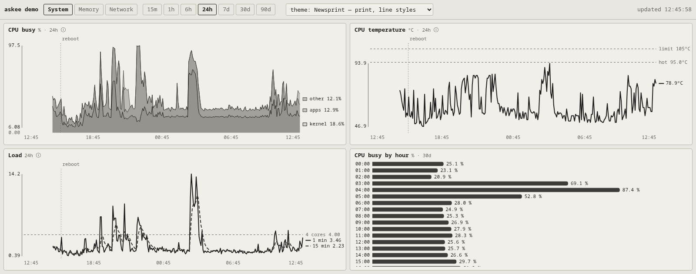
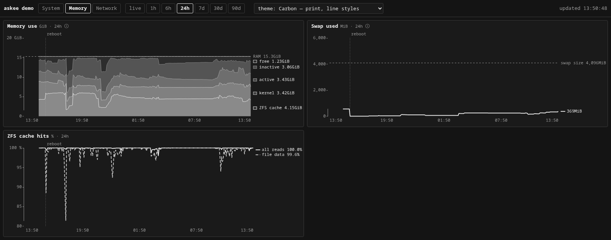
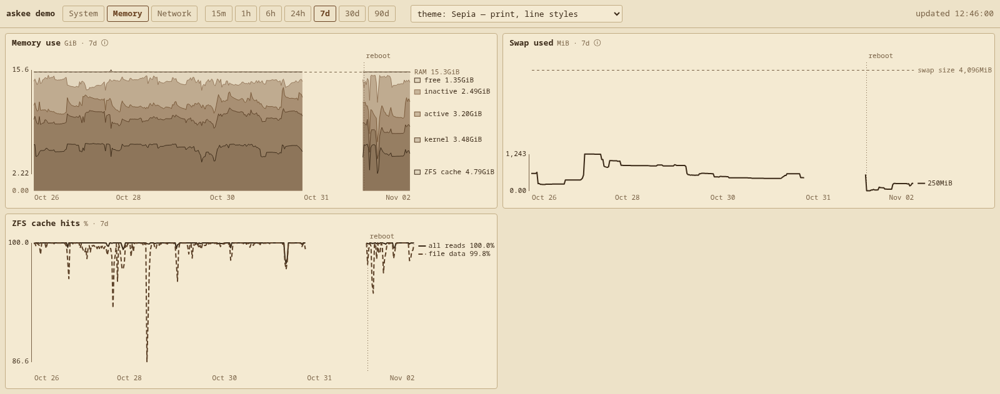
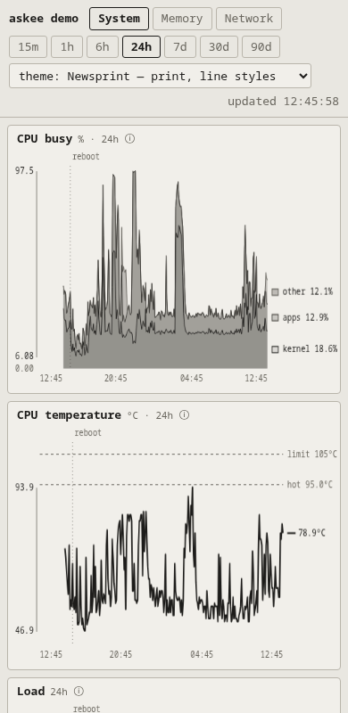
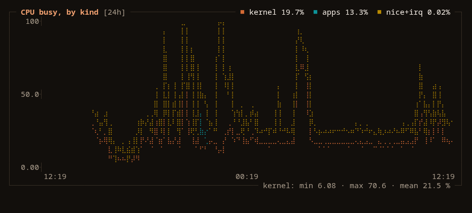
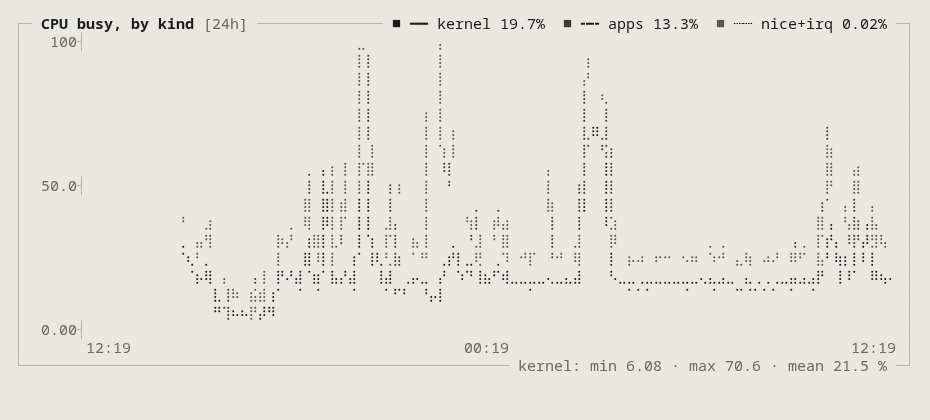
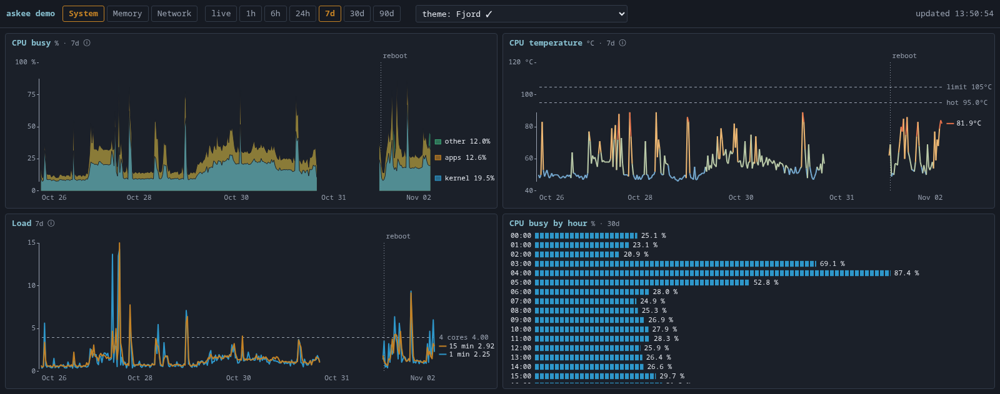

# askee

Small, dependency-free charts for the terminal and the browser, read from a
Prometheus-compatible database (VictoriaMetrics, Prometheus). One Go binary, standard library
only: nothing to download, no build step beyond `go build`, and it runs from a recovery shell.

The standard charts for a machine — CPU, memory, disks, network, ZFS, DNS — come built in, as
packs that work on Linux and FreeBSD alike and hide whatever your machine does not have. Your
own charts go in a JSON file. askee draws both three ways: a tiled web dashboard that fills
whatever screen it is on, a btm-style deck in the terminal, and plain-text panels for scripts
and LLM tools to read.

```sh
askee -vm http://127.0.0.1:8428 -serve 127.0.0.1:8095   # no config: every built-in pack
```



## Accessible first

The default theme, **auto (system)**, is a print theme: **Light** on a light system, **Dark** on a dark one,
switched automatically. Print themes use one ink. Lines tell themselves apart by dash pattern
— solid, dashed, dotted, dash-dot — and stacked bands by shades of grey, the way a chart in a
newspaper or an old book does. A chart stays readable with no colour at all: on a
black-and-white printer, on a monochrome screen, and for anyone who does not see colour the way
the designer did.



The rest follows the same idea, after Tufte's *The Visual Display of Quantitative Information*:

- **Colour themes are checked, not eyeballed.** Each palette, in order, was run through a
  colour-blindness validator against its own background (adjacent-pair ΔE ≥ 8 under protan and
  deutan simulation, ΔE ≥ 15 for normal vision, ≥ 3:1 contrast). The picker shows plain names; a theme's hover note says if it fails the check.
- **No legend to decode.** Each line is named at its right end, with its latest value, beside a
  sample of its own line style. Stacked bands are named at their middle.
- **Numbers are printed, not left to the eye.** There is no grid. The y axis is a range frame: a
  hairline as long as the data's range, labelled with the data's actual min and max. Every bar
  carries its value.
- **Short titles.** A chart's title says what it shows in a few words; the sentence on what it
  means waits behind the ⓘ beside it.
- **Compared to what.** Reference lines carry the comparison — installed RAM, swap size, core
  count, a drive's own warning temperature — dashed and quiet, so the data stays the loudest
  ink. Events such as reboots are marked on every chart, so a step in a line explains itself.
- **Small multiples.** Series on very different scales get a panel each, on one time axis,
  instead of one chart where the smallest line lies flat along the bottom.
- **Text stays readable.** Fonts never shrink below 11 px. A chart with many bars takes more
  room on the grid, and if it still does not fit, it scrolls inside its tile instead of
  shrinking.
- **Live, without a database.** The `live` range ticks every second, like btm. With
  `live_source` set to an exporter's `/metrics` URL, askee reads it once a second **only while
  someone is watching**, keeps five minutes in memory and stores nothing; the older part of the
  window is filled from the database until those five minutes are read. Live pages are computed
  from a small PromQL subset (`rate`, `sum`/`avg`/`max`/`min` with or without `by`, label matchers,
  arithmetic, `^`, `or`, `vector(n)`, `histogram_quantile`). `live_sources` adds more `/metrics`
  URLs (a DNS server's own, say), all read at once each second. Live `rate()` looks back five
  seconds, not one: ZFS writes in bursts every five seconds and FreeBSD counts disk busy time
  in whole seconds, so a one-second rate flicks between nothing and a spike. A page sets
  `live_window` (up to `2m`) for a counter that moves more slowly still. A page marked live whose query falls outside it does not load, so a live
  mark never covers a chart quietly drawn from the database. Other ranges stand still and
  repaint in place on a cadence that suits them (1 min for 1h, 5 min beyond).
- **Every chart shows the range you picked.** A chart that covers a stretch of time follows the
  picker. Each tab has a floor, the shortest range all its charts can show, and ranges below it
  are greyed out: a tab of daily figures starts at 7d. Tabs where every chart can go live carry
  a small dot. A chart that is a reading (a figure now, a snapshot) does not follow the picker
  and its header says "now" or "snapshot". An hour-of-day pattern keeps its own window (30d) the
  same way. On the live range, every chart not drawn live adds "not live" to its header. Moving to a tab with a higher floor shows the floor,
  and moving back returns to the range you picked.
- **Instant.** The server answers from a cache it keeps warm and refreshes behind the reader;
  the page keeps every group it has seen and fetches the neighbours in the background, so
  ←/→ draws at once. `test/perf.mjs` holds it to a budget (below).
- **Keyboard and touch.** ←/→ move between groups of charts, ↑/↓ between pages, 1–7 pick the
  time range, `t` cycles themes and `a` returns to automatic. Swipe left and right on a phone.
  The quiet `?` in the corner (or the `?` key) lists the keys and offers the themes as buttons,
  for a phone. The time range and the pager sit in a bar right above the charts they drive.
- **Not yet:** extremes are not labelled where they happen ("max 97 % 03:12"). The `latest /
  min / max / mean` line in `-print` carries them for now.

## The three faces

### Web dashboard

One group of charts per screen. Charts are packed into a grid sized to the viewport — three
columns on a big display, two on a laptop, one on a phone — and a chart that needs more room
spans more cells. When a group has more charts than fit, it gets pages; on a phone the group
is one page that scrolls, and holds still while the address bar slides in and out.



```sh
askee -serve 127.0.0.1:8095
```

It is read-only and takes no query text from the browser: only a group name and one of the
fixed time ranges. Every query comes from your config file.

**Edit the config, no restart.** The server checks the file every 30 s and reloads it when it
changes; open pages pick up new or renamed groups by themselves. A file that does not load (a
half-saved edit, a typo) is reported on stderr and the running catalogue stays. The database
URL and `live_source` still need a restart.



### Terminal deck

Braille line graphs (2 × 4 dots per character cell) and eighth-block bars. ←/→ or a click on
either half of the screen move between charts, ↑/↓ change the time range, `t` the theme.
Truecolor when the terminal says so, the nearest xterm-256 colour otherwise.





```sh
askee                      # finds the config: $ASKEE_CONFIG, ./askee.json,
                           # ~/.config/askee/askee.json, /usr/local/etc/askee/askee.json
askee -config my.json      # or name it
```

### Plain text

Boxed panels plus a numeric line per series, so a script — or an LLM reading a health check —
never has to estimate a value from the height of a glyph.

```
$ askee -config my.json -print system -range 24h -size 72x9

┌─ CPU busy [24h] ──────────────── ■ ━━ kernel 18.6%  ■ ╍╍ apps 12.9% ─┐
│  97.5┤        ┊reboot    ⢰     ⣶           ⣄                         │
│      │        ┊          ⢸ ⡇  ⢀⢿          ⢸⢘                 ⡀       │
│      │        ┊      ⢀⢸⡄⢠⢸⡄⡇⣀ ⢸⠈ ⡇      ⡄ ⢸⠉⢇                ⣷ ⢠⡄    │
│      │      ⢤⢀┊   ⢀⢀ ⣸⣸⡇⣾⣿⢇⢸⡏ ⢸  ⣧⣴ ⣦  ⢠⡇ ⡟ ⢸⡇              ⢠⣿ ⣮⣷ ⣠⡄ │
│      │      ⠱⡫⡄⣄⣀ ⢸⡿⣄⡟⣿⢱⣹⡏⠘⢾⣷⣀⣛⢀⠞⡧⢼⣤⢬⣓⣀⣚⣘⣀⡇ ⠘⣗⣒⣀⣒⣒⣀⣪⣓⣀⣒⣓⣀⣚⣚⣄⣿⠟⣷⠎⠻⣄⢼⡅ │
│  6.08┤        ⠙⠺⠛⠎⠛⠁           ⠉                                     │
│       12:46                       00:46                        12:46 │
└────────────────────────── kernel: min 6.08 · max 70.6 · mean 21.5 % ─┘
  kernel             latest 18.6     min 6.08     max 70.6     mean 21.5     % (n=259)
  apps               latest 12.9     min 3.60     max 85.1     mean 14.5     % (n=259)
  other              latest 12.1     min 0.00     max 24.5     mean 0.76     % (n=259)
  so what: Kernel time includes ZFS and disk encryption.
```

## Themes

Nine, shared by every face, in three kinds. Pick with the drop-down, `t`, `?theme=sepia` in the
URL, or `ASKEE_THEME=sepia` in the terminal.

| theme | kind | colour-blind check | look |
|---|---|---|---|
| **newsprint** (shown as Light) | print | one ink, line styles | greyscale on newsprint — the light default |
| **sepia** | print | one ink, line styles | brown ink on old paper |
| **carbon** (shown as Dark) | print | one ink, line styles | greyscale on charcoal — the dark default |
| phosphor | print | one ink, line styles | green CRT |
| amber | print | one ink, line styles | amber CRT |
| ember-chalk | flat | passes | copper and chalk on warm grey |
| fjord | flat | passes | muted Nord-like slate |
| chalkboard | flat | borderline, so lines are also dashed | chalk on slate green |
| terminal | flat | **fails** (yellow and green) | the standard xterm-256 colours |

**Print** themes use one ink and tell lines apart by dash pattern. **Flat** themes use a few
solid, chalky colours; colour only ever names a series or carries a temperature.




## Chart styles

Seven, and every page is one of them. Each follows the same rules: a title of a few words,
numbers printed, a comparison on the chart, no legend to decode.

| style | config | use it for |
|---|---|---|
| **line** | `kind: line` | one to four series over time. Named at the right end; reference values dashed. `log` for values spanning orders of magnitude (latency). |
| **stack** | `kind: line`, `stack: true` | parts of a whole over time (memory, CPU by kind). Bands are solid tints, named at their middle. |
| **range** | `kind: line`, `lo` + `hi` on a series | a level and its spread over time (heart rate): the line, with a pale band from its lowest to highest in each point behind it. |
| **days** | `kind: days` | one figure per day (sleep, steps, a night's heart rate variability). `mark: bar` for an amount from zero, stackable; `mark: dot` for a level, joined only to a day that has one. `baseline` shades the reader's usual range behind each day. Each day prints its number when there is room. |
| **small multiples** | `kind: line`, `split: true` | series on very different scales (free space per pool): one panel each, one time axis. |
| **bars** | `instant`, `runs`, `hour` | a ranked list or a profile. Block cells, value at the end, a reference rule where one exists. |
| **blocks** | `capacity`, `sizes` | how full something is, or what fills it: a row of cells per thing, free space as empty cells. |
| **clock** | `kind: clock` | when in the day something happens, day after day (sleep stages, movement): one row per day on a shared clock axis, the actogram sleep researchers draw. Cell height carries the value, so it reads in one ink; each row ends with its number. |
| **table** | `snapshot` | a handful of numbers a reader would rather read than estimate. |

Horizontal bars are drawn as runs of small cells, like a row of `█` in a terminal — the same
look in the browser, the deck and `-print`.

## Install

```sh
git clone https://github.com/jtrotsky/askee.git && cd askee
go build -o askee .
./askee -packs
./askee -vm http://127.0.0.1:8428 -print system
```

Go 1.27 or later. Builds and runs on FreeBSD, Linux and macOS (`GOOS=linux go build`); the
terminal deck needs `stty`.

## Packs

The standard charts ship inside the binary. Each is written for
[node_exporter](https://github.com/prometheus/node_exporter) on Linux **and** FreeBSD at once,
and assumes nothing else about the machine.

| pack | group | charts |
|---|---|---|
| `system` | System | CPU busy (kernel, apps, waiting), CPU temperature, load against the core count, CPU by hour |
| `memory` | Memory | memory use (FreeBSD or Linux accounting, whichever the machine reports), swap against its size, ZFS cache misses and size |
| `storage` | Storage | fullest filesystems, free space on `/`, disk traffic |
| `network` | Network | traffic on the physical network cards, traffic by interface |
| `blocky` | DNS | queries, share blocked, answer time, answers by type — for the [blocky](https://github.com/0xERR0R/blocky) DNS proxy |

How a pack stays portable:

- **Where Linux and FreeBSD name a metric differently, the query asks for both** with `or`
  (`node_memory_swap_used_bytes or SwapTotal - SwapFree`; `node_zfs_arcstats_*` or
  `node_zfs_arc_*`).
- **A page that only makes sense on some machines says what it needs**, in `requires`: a query
  that must return something for the page to be shown. A machine without ZFS has no ZFS charts,
  one without swap has no swap chart, a CPU without a sensor has no temperature chart. Nothing
  is drawn empty. askee checks once at start; a server starting alongside its database waits up
  to two minutes for it before deciding.
- **Network traffic counts physical cards only**, recognised by driver name (`eth*`, `en*`,
  `wl*`, `igc*`, `em*`, `vtnet*`, …), so bridges, VPN tunnels, jails and containers are not
  counted twice. Every interface still appears in "Traffic by interface".
- **Rates have an explicit window**, `$__rate`, sized from `scrape_interval` (four scrapes at
  least, like Grafana's `$__rate_interval`), so every query runs on Prometheus as well as
  VictoriaMetrics.
- **`$node` stands for `node_filter`**, so a database that holds many machines can be charted
  one at a time: `"node_filter": "instance=\"web1:9100\""`.

A config with no pages of its own and no `packs` key gets every pack. To change one chart, give
your own page the pack page's id and it takes that page's place; to drop one, list its id in
`hide`. A group you list in `groups` keeps your order and your title.

```json
{
  "title": "web1",
  "vm": "http://prometheus:9090",
  "scrape_interval": "15s",
  "node_filter": "instance=\"web1:9100\"",
  "packs": ["system", "memory", "storage", "network"],
  "hide": ["cpu_hour"],
  "pages": [
    {"id": "temp", "group": "system", "kind": "line", "title": "CPU temperature", "unit": "°C",
     "thermal": true, "series": [{"expr": "max(node_hwmon_temp_celsius{chip=\"platform_coretemp_0\"})", "name": "package"}],
     "refs": [{"value": 100, "label": "limit"}]}
  ]
}
```

Use `$__rate` and `$node` in your own pages too.

## Tests

```sh
go test ./...                            # every page of the example renders, at every range,
                                         # against a fake Prometheus API — no database needed
go test -run XXX -bench Group .          # one group built from scratch (about 10 ms)
node test/perf.mjs http://127.0.0.1:8095/  # a real headless Chrome: fetch, draw and live tick
                                           # for every group and range, against a budget
node test/phone.mjs http://127.0.0.1:8095/ # the same Chrome at phone size: the page must not
                                           # rebuild or jump when the address bar moves
```

`go test` also checks every pack: that it parses, that page ids are unique across packs, that
every `rate()` has a window (Prometheus needs one), and that `$node` and `requires` behave.

The browser test needs Node 22+ and Chrome or Chromium (`CHROME=` to point at it). It fails
if a fetch takes over 150 ms, a draw over 100 ms, or a live tick over one 16 ms frame.

## The config

```jsonc
{
  "title": "my-box",
  "vm": "http://127.0.0.1:8428",          // -vm or $ASKEE_VM override it
  "packs": ["system", "memory"],          // built-in charts (see Packs); absent = all, if no pages
  "hide": [],                             // pack page ids to leave out
  "node_filter": "",                      // label matcher for $node, e.g. instance="web1:9100"
  "scrape_interval": "60s",               // the database's; sets the $__rate window
  "default_range": "24h",
  "default_theme": "auto",                // Light (newsprint) on light systems, Dark (carbon) on dark
  "thermal_range": [30, 100],             // °C mapped to the cool→hot scale, the same in every chart
  "events": [{"label": "reboot", "expr": "node_boot_time_seconds"}],  // value = a unix time
  "live_source": "http://127.0.0.1:9100/metrics?collect[]=cpu&collect[]=loadavg&collect[]=netdev",
  "live_sources": ["http://127.0.0.1:4000/metrics"],      // optional: more exporters read live
  "snapshot": "/path/data.md",            // optional: `### key` sections written by another job
  "sizes": "/path/sizes.txt",             // optional: TARGET LOCAL REMOTE BILLED table
  "price_per_tb": 7.50, "price_label": "cold $/mo",
  "groups": [{"id": "system", "title": "System"}],
  "pages": [
    {"id": "load", "group": "system", "kind": "line", "title": "Load",
     "info": "Above 4, the core count, work is queueing.",
     "series": [{"expr": "node_load1", "name": "1 min"}, {"expr": "node_load15", "name": "15 min"}],
     "refs": [{"value": 4, "label": "4 cores"}]}
  ]
}
```

| kind | draws | keys |
|---|---|---|
| `line` | time series | `series[]` (`expr` + `name`, or `label` to name each result), `refs[]` (`value` or `expr`, + `label`), `ymin`/`ymax` (the axis reaches at least these, so a quiet chart lies flat instead of blowing noise up to full height; `ymax: 100` is also a hard top, for percentages), `stack` for parts of a whole, `split` for one panel per series on its own scale, `thermal` to colour a line by temperature, `live` to follow the live range, `live_window` for how far a live `rate()` looks back (default `5s`), `log` for a log scale, `lo` and `hi` on a series for a range drawn behind it (`min_over_time(x[$__step])`, where `$__step` is the width of one point) |
| `days` | one slot per local calendar day. Each `expr` is evaluated hourly, with windows covering each clock hour exactly (so a figure stamped at midnight lands in its own day), and a day's hourly values reduce by `day`: `max` (default: daily figures, running totals), `sum` (rollups of finer data), `min` or `last`. Write exprs as hourly rollups: `max(last_over_time(x[1h]))`, `sum(count_gt_over_time(x[1h], 2)) * 15`. With `min_range` it widens itself (7 days at the 24h setting, its tag saying so) and does not raise its tab's floor | `series[]`, `mark` (`bar` or `dot`), `stack` (bars only), `day`, `baseline` (days: mean ± one standard deviation of the first series over that many days before each, once there are five), `refs[]`, `ymin`/`ymax` |
| `hour` | mean by hour of day over a fixed window (`range`, default 30d), as bars; a pattern, so it does not follow the picker | `expr` |
| `capacity` | how full each thing is, as block rows | `key`: a snapshot section of `name (USED of TOTAL UNIT)` lines; `refs` in % |
| `instant` | one bar per result of an instant query: a reading now, or, with `$__range` in the query (`increase(x[$__range])`), a total over the selected range | `expr`, `label`, `min_value`, `limit` |
| `runs` | one bar per run of a job, de-duplicated on the run's own timestamp | `expr`, `key` |
| `snapshot` | a section of the snapshot file; a bar figure becomes real bars | `key` |
| `sizes` | a backup sizes table as block rows, one per store, split by target | — |
| `clock` | one row per day, time of day across, cells `cell` minutes wide. With `states` (top to bottom, first tallest) each cell is a state and the row's number is the hours in every state but the first; without, cells are shaded and sized by amount and the number is the minutes at or above `threshold`. A window crossing midnight is named by the day it ends on. Rows before the first reading are left off; a day with none inside the data is a blank row | `expr` (one series; wrap in `last_over_time(x[<cell>m])`), `clock`: `from` (hour), `hours`, `cell` (minutes), `states[]` (`value` + `name`), `threshold`, `count` (what `-print` calls the row's number) |

Every page also takes `title` (what, in a few words), `info` (so what, one sentence, behind the ⓘ; `subtitle` is the old name and still read), `unit`, `range` (`now` or
`snapshot`, for a reading), `min_range` (the shortest range a chart covering time can show, e.g.
`7d` for daily data; it raises its tab's floor), `note` (a visible label under the chart, 50 characters at most — explanations go in `info`), `empty` (said instead of "no data in this range", e.g. what the data is waiting for), `requires` (a query that must return something, or the page is left out), and `span: [columns, rows]` to give it more of the grid. A tile's header names the range it
actually draws. A chart covering time cannot pin its own `range`: askee refuses to load it and
asks for `min_range`, so no chart ever shows a different span from the one the picker names.

A page whose title has a comma or dash, whose `info` runs to two sentences or splices them with
a semicolon or dash, or whose `note` is longer than a label, does not load: askee names the page and the rule. On a live reload the previous catalogue keeps serving.

A line breaks where data is missing: a gap longer than three steps, or one and a half of the
series' own sampling interval if that is longer, so a figure recorded once a day draws as a
line on a 90-day chart. A lone point is drawn as a dot.

## How it works

The binary holds everything: the web page is embedded, the colour maths and the braille
drawing are plain Go. Every expression comes from the config; the web API accepts only a group
id and a range. Each face asks the same page definition for its data, so a chart reads the same
in the browser, the terminal and a script.

## Report kit

`ascii/` is the companion for written reports: `ascii-chart.sh` draws bars, gauges, stacks,
sparklines and braille line plots in plain `sh` and `awk`, and `render.sh` turns a Markdown
subset into one self-contained HTML file. See [`ascii/README.md`](ascii/README.md).

## License

MIT
