# askee

askee is a dashboard for metrics you already collect. It reads a
Prometheus-compatible database (Prometheus or VictoriaMetrics) and draws its
charts in a terminal, in a browser, or as plain text. It is one Go binary,
built from the standard library alone.

askee does not collect anything. You bring the data.

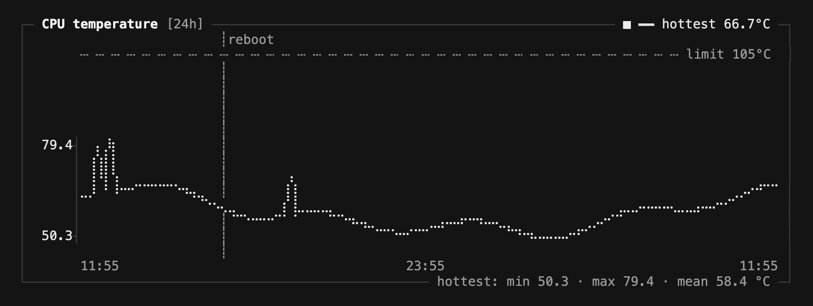

*One page of the terminal view in `carbon`, drawn with `askee -dump 2`. The
dashed line is the sensor's limit and the dotted mark is a reboot. The data is
synthetic, served by a stand-in Prometheus API. Screenshots here use the two
default themes, `carbon` on dark and `newsprint` on light.*

## How it works

```
 your machines                your database                 askee
 node_exporter, etc.  ──▶  Prometheus / VictoriaMetrics  ◀──  queries it  ──▶  terminal
 (expose /metrics)          (scrapes and stores)              (PromQL from      browser
                                                               your config)     plain text
```

1. **Something exports metrics.** [node_exporter](https://github.com/prometheus/node_exporter)
   on each machine is the usual start. Any exporter works.
2. **Your database scrapes and stores them.** askee needs its query URL. It
   keeps no database of its own and writes nothing to disk.
3. **A config file says what to draw.** Each chart is a page with a PromQL
   query. Built-in packs cover node_exporter, so with no config at all askee
   shows every pack: CPU, memory, storage, network and the blocky DNS proxy.
4. **askee asks the database when someone looks.** The terminal, the web page
   and the text output all run the same queries from the same config, so a
   chart reads the same in each.

A built-in page that needs something a machine lacks, such as ZFS or a
temperature sensor, is left out when its query returns nothing.

## The design language

askee draws like a print chart: one ink on a plain ground, monospace type,
and every number written down. The default themes are greyscale, `carbon` on
a dark screen and `newsprint` on a light one. These rules can be lifted into
any dashboard.

- **Line style before colour.** In the one-ink themes, lines are told apart by
  dash pattern (solid, dashed, dotted, dash-dot, long dash), so a chart reads
  in greyscale and for readers who do not see colour the usual way. The colour
  themes are checked for colour blindness against their own background, and
  `askee -themes` prints the result.
- **Names on the lines.** Each line carries its name and latest value at its
  right end. There is no legend.
- **The axis fits the data.** The y axis runs from the data's own minimum to
  its maximum.
- **Limits as dashed lines.** A reference value, such as a core count or a
  sensor's limit, is a named dashed line. An event, such as a reboot, is a
  dotted mark.
- **Numbers, not just shapes.** The text view prints `latest / min / max /
  mean` under every chart, so nobody has to judge a value from the height of
  a dot.
- **Text in the terminal.** Lines are braille (2 × 4 dots per character) and
  bars are eighth-blocks, so a chart is drawn in characters and works over SSH.
- **Short words, enforced.** askee refuses a page whose title holds a comma or
  a dash, whose `info` runs past one sentence, or whose `note` passes 50
  characters. It names the page and the rule.

## Install

```sh
git clone https://github.com/jtrotsky/askee.git
cd askee
go build -o askee .
```

It needs Go 1.27 or later and nothing else. It builds for FreeBSD, Linux and
macOS, not Windows (the terminal view uses `stty`).

## Use

Point askee at your database:

```sh
askee -vm http://127.0.0.1:9090 -print system           # plain text, then exit
askee -vm http://127.0.0.1:9090                         # terminal view
askee -vm http://127.0.0.1:9090 -serve 127.0.0.1:8095   # web dashboard
```

To choose packs or add your own charts, write a config file, `askee.json`:

```json
{
  "title": "demo",
  "vm": "http://127.0.0.1:9090",
  "scrape_interval": "15s",
  "packs": ["system", "memory"]
}
```

askee looks for `$ASKEE_CONFIG`, then `./askee.json`, then
`~/.config/askee/askee.json`, then `/usr/local/etc/askee/askee.json`. Here is
part of `-print system` from synthetic data, shown as an image because
GitHub's code font has no braille:

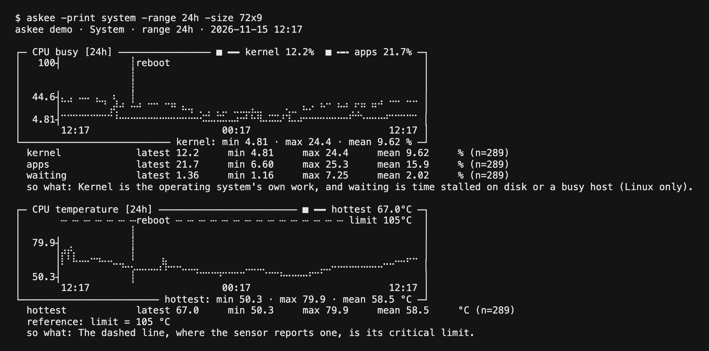

The number lines are plain text, so scripts can read them:

```
  kernel             latest 8.69     min 4.54     max 30.4     mean 8.26     % (n=289)
  apps               latest 26.1     min 7.75     max 44.2     mean 20.3     % (n=289)
  hottest            latest 54.6     min 46.9     max 69.9     mean 52.4     °C (n=289)
```

### Flags

| flag | what it does |
|---|---|
| `-config FILE` | the config file (see above for where askee looks without it) |
| `-vm URL` | the database URL. Overrides the config's. Also `$ASKEE_VM` |
| `-print GROUP` | print one group of charts as text and exit |
| `-range R` | range for `-print`: `live`, `1h`, `6h`, `24h`, `7d`, `30d` or `90d` |
| `-size WxH` | size of each chart for `-print` and `-dump` (default `100x14`) |
| `-dump N` | draw page N once, with colour, and exit. Needs no terminal |
| `-serve ADDR` | serve the web dashboard on this address |
| `-page N` | page the terminal view opens on |
| `-packs` | list the built-in packs |
| `-themes` | list the themes and whether each passed the colour-blindness check |

## Three views of one config

**Terminal.** One chart per screen. Lines are drawn in braille (2 × 4 dots per character)
and bars in eighth-blocks. ←/→ or `h`/`l` move between charts, ↑/↓ or `k`/`j` change the
range, `1` to `7` pick a range, `t` changes the theme and `q` quits. It uses truecolour when
`$COLORTERM` says the terminal has it, and the nearest xterm-256 colour otherwise.

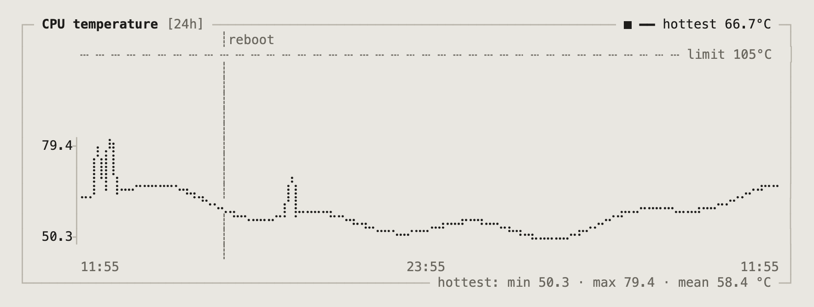

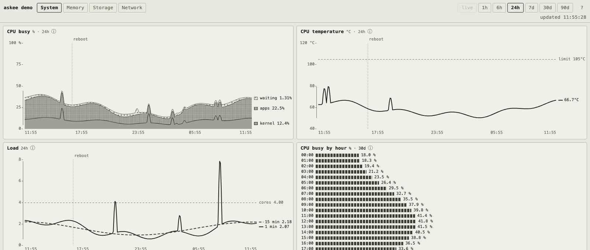

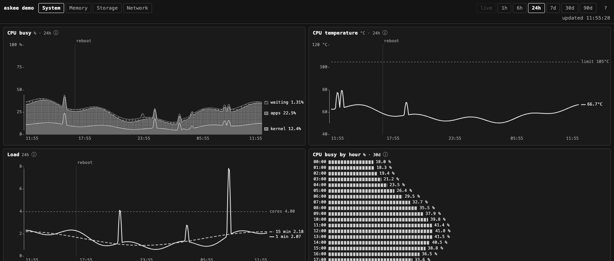

**Web.** A grid of charts sized to the window, one group per screen. The page is built into
the binary. The browser can ask only for a group and one of the fixed ranges. Every query
comes from the config file, so the dashboard runs no query text sent to it. askee rereads the
config every 30 seconds and picks up changes without a restart. The database URL and the live
sources still need one.

**Text.** `-print` draws a group as boxed panels with a numbers line per series, for scripts,
health checks and anything else that reads text.

## Built-in packs

Each pack works with node_exporter on both Linux and FreeBSD. Where the two name a metric
differently, the query asks for both. A page that needs something a machine lacks, such as ZFS,
swap or a temperature sensor, names it in `requires` and is left out when the query returns
nothing. On a Linux machine without ZFS, the `memory` pack shows 3 of its 6 pages.

| pack | pages | charts |
|---|---|---|
| `system` | 4 | CPU busy by kind, CPU temperature, load against the core count, CPU busy by hour of day |
| `memory` | 6 | memory use (FreeBSD or Linux accounting), swap used, swap activity, ZFS cache misses and size |
| `storage` | 3 | fullest filesystems, free space on `/`, disk traffic |
| `network` | 2 | traffic on physical network cards, traffic by interface |
| `blocky` | 4 | queries, share blocked, answer time and answers by type for the [blocky](https://github.com/0xERR0R/blocky) DNS proxy |

A config with no pages of its own and no `packs` key gets every pack. To replace one pack
chart, give your own page the same `id`. To drop one, list its id in `hide`. `$node` in a query
stands for the config's `node_filter`, so one database that holds many machines can be charted
one machine at a time:

```json
{
  "title": "web1",
  "vm": "http://prometheus:9090",
  "node_filter": "instance=\"web1:9100\"",
  "packs": ["system", "memory", "storage", "network"],
  "hide": ["cpu_hour"]
}
```

## Your own charts

A page is one chart. Each has an `id`, a `group`, a `kind`, a short `title` and usually one or
more PromQL expressions:

```json
{"id": "load", "group": "system", "kind": "line", "title": "Load",
 "info": "Above 4, the core count, work is queueing.",
 "series": [{"expr": "node_load1", "name": "1 min"}, {"expr": "node_load15", "name": "15 min"}],
 "refs": [{"value": 4, "label": "4 cores"}]}
```

| kind | draws |
|---|---|
| `line` | series over time. `stack` for parts of a whole, `split` for one panel per series, `log` for a log scale, `lo` and `hi` for a band behind a line, `thermal` to colour a line by temperature |
| `days` | one figure per calendar day, as bars or dots, with an optional band for the usual range |
| `hour` | the mean for each hour of the day over a fixed window (30 days by default) |
| `clock` | one row per day across a clock face, for when in the day something happens |
| `instant` | one bar per result of an instant query |
| `runs` | one bar per run of a job |
| `capacity` | how full each thing is, as rows of cells |
| `snapshot` | a section of a Markdown file written by another job |
| `sizes` | a table of sizes per target and store, as rows of cells |

A page that breaks the writing rules (see The design language) is refused. On a live reload
the last good config keeps serving.

Each key is listed, with a comment, in the `PageCfg` type in [`config.go`](config.go). The pack
files under [`packs/`](packs) are working examples of `line`, `instant` and `hour` pages.

## Themes

Nine themes, shared by all three views. Choose one with `t`, `?theme=sepia` in the URL, or
`ASKEE_THEME=sepia` in the terminal. The default follows the system: `newsprint` on a light
screen and `carbon` on a dark one.

Five themes use one ink and tell lines apart by dash pattern, so a chart stays readable in
greyscale and for readers who do not see colour the usual way: `newsprint`, `sepia`, `carbon`,
`phosphor` and `amber`. Four use colour. `fjord` and `ember-chalk` pass a colour-blindness check
against their own background. `chalkboard` sits just under it, so its lines are also dashed.
`terminal`, the plain xterm colours, fails (yellow against green). `askee -themes` prints each
palette and its result.

### The other themes

The same System page in each of the seven themes beyond the two defaults.

**ember-chalk**, warm grey with ember and teal

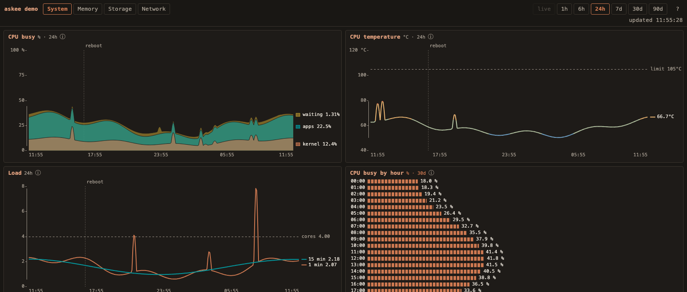

<table>
<tr>
<td width="50%"><b>fjord</b>, slate and muted blue<br>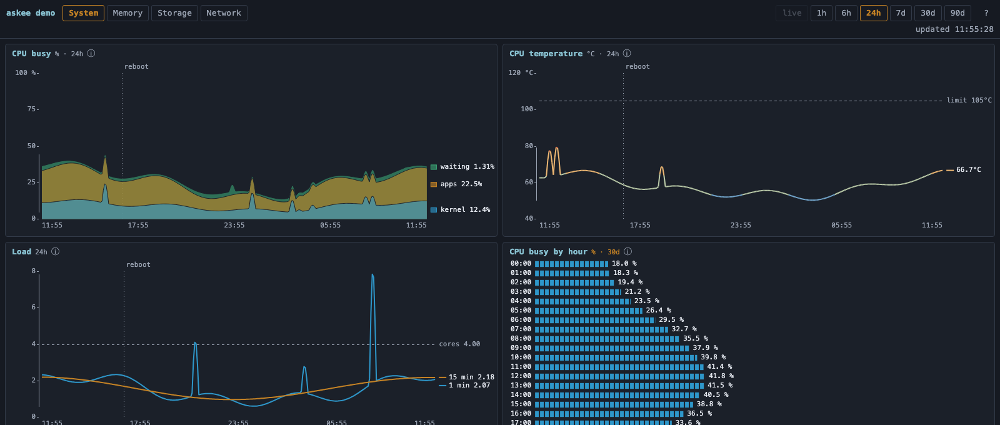</td>
<td width="50%"><b>chalkboard</b>, chalk on slate green<br>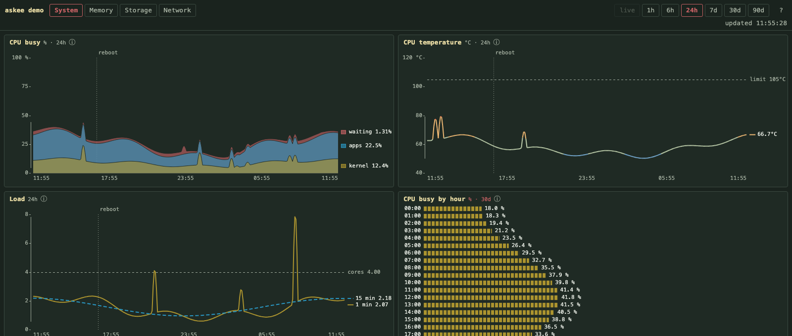</td>
</tr>
<tr>
<td><b>sepia</b>, brown ink on old paper<br>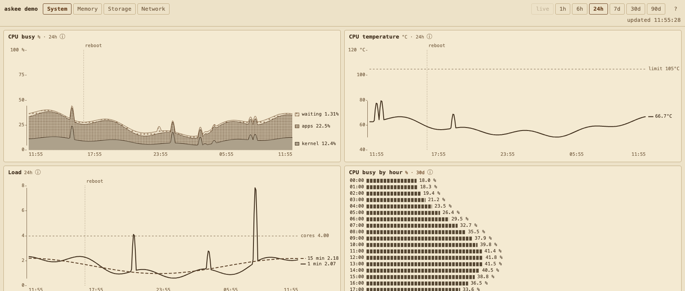</td>
<td><b>phosphor</b>, a green CRT<br>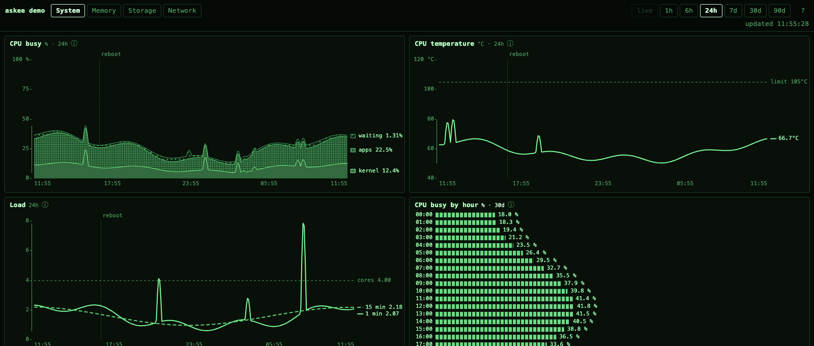</td>
</tr>
<tr>
<td><b>amber</b>, an amber CRT<br>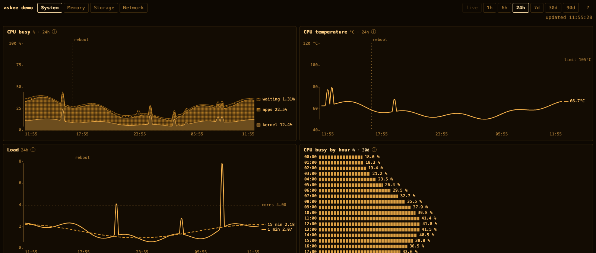</td>
<td><b>terminal</b>, the plain xterm colours<br>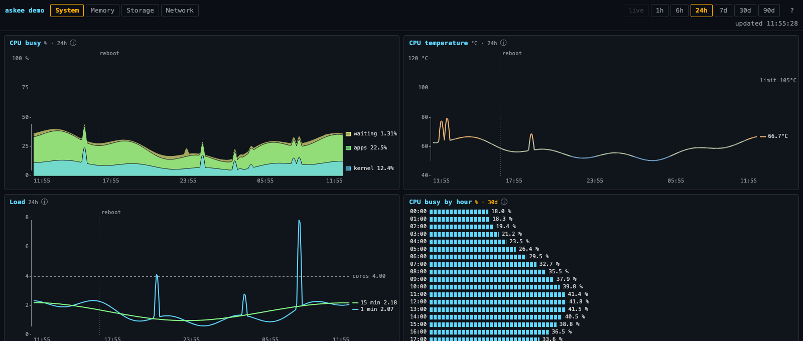</td>
</tr>
</table>

## Live range

Set `live_source` to an exporter's `/metrics` URL and the `live` range updates once a second.
askee reads the exporter only while someone is watching, keeps the last five minutes in memory
and stores nothing. It computes live charts from a small subset of PromQL (`rate`, `sum`, `avg`,
`max`, `min`, label matchers and arithmetic).

## Tests

```sh
go test ./...
```

The tests run against a fake Prometheus API, so they need no database. They render every page
of [`examples/node-exporter.json`](examples/node-exporter.json) at every range and check that
each pack parses, that page ids are unique and that every `rate()` has a window.
[`test/perf.mjs`](test/perf.mjs) times the web page in headless Chrome against a budget.

## Report kit

[`ascii/`](ascii) is a separate set of `sh` and `awk` scripts for written reports. It draws bars,
sparklines and braille line plots as text, and turns a Markdown subset into one self-contained
HTML file. See [`ascii/README.md`](ascii/README.md).

## Licence

MIT. See [LICENSE](LICENSE).
