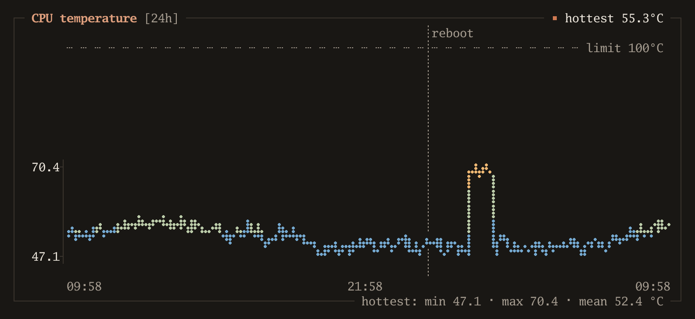
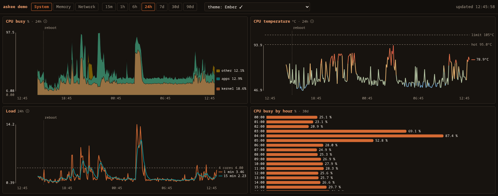

# askee

askee draws charts from a Prometheus-compatible database (Prometheus, VictoriaMetrics) in a
terminal, in a browser, or as plain text. It is one Go binary built from the standard library
alone.



*One page of the terminal view, drawn once with `askee -dump 2` in the `ember-chalk` theme.
The line is coloured by temperature. The dashed line is the sensor's limit, and the dotted
mark is a reboot. The data is synthetic: a stand-in Prometheus API serving made-up values.*

## Why

One chart definition draws in three places: a terminal over SSH, a browser on a phone, and
the text a script reads. All three ask the same page for the same data, so a chart reads the
same in each. askee needs no browser and no database of its own. It queries the
database you already run and writes nothing to disk, so it works from a recovery shell.

Each chart prints its numbers as well as its line. A line carries its name and latest value at
its right end, so there is no legend to decode. The y axis runs from the data's own minimum to
its maximum. Reference values, such as the core count or a sensor's limit, are drawn as dashed
lines on the chart. The plain-text output adds a `latest / min / max / mean` line per series,
so a script never has to judge a value from the height of a dot.

## Install

```sh
git clone https://github.com/jtrotsky/askee.git
cd askee
go build -o askee .
```

It needs Go 1.27 or later and has no other dependencies. It builds for FreeBSD, Linux and
macOS. It does not build for Windows. The terminal view uses `stty`.

## Use

Point askee at a database that holds [node_exporter](https://github.com/prometheus/node_exporter)
metrics. With no config file it shows every built-in pack:

```sh
askee -vm http://127.0.0.1:9090 -print system     # plain text, then exit
askee -vm http://127.0.0.1:9090                   # terminal view
askee -vm http://127.0.0.1:9090 -serve 127.0.0.1:8095   # web dashboard
```

To choose packs or add charts of your own, write a config file. This one was saved as
`askee.json`:

```json
{
  "title": "demo",
  "vm": "http://127.0.0.1:9090",
  "scrape_interval": "15s",
  "packs": ["system", "memory"]
}
```

askee finds it without a flag. It looks for `$ASKEE_CONFIG`, then `./askee.json`, then
`~/.config/askee/askee.json`, then `/usr/local/etc/askee/askee.json`. Here is part of the
output, again from synthetic data (two of the four charts in the group):

```
$ askee -print system -range 24h -size 72x9
demo · System · range 24h · 2026-11-14 09:58

┌─ CPU busy [24h] ──────────────── ■ ━━ kernel 8.69%  ■ ╍╍ apps 26.1% ─┐
│                                            ┊reboot                   │
│  78.7┤                                     ┊    ⣆⣰                   │
│      │                                     ┊     ⢸                   │
│      │⡄  ⢀⢀ ⣦⢤ ⢦⣤ ⣄⣄ ⣀⡀ ⣀⣀                 ┊     ⢸             ⣀  ⣀⣀ │
│      │⠈⠋ ⠋⠉        ⠈  ⠛ ⠉  ⠋⠉ ⠢⣤ ⣤⣀ ⠦⠴ ⣤⠶ ⡴⠶ ⣤⢄⡗⠛⢹ ⢆⣠ ⡤⢤ ⠦⢤ ⠦⢴ ⠋⠙ ⠁  │
│  4.54┤⠢⠦⠒⠒⠶⠖⠒⠶⠲⠒⠖⠲⠦⠶⠒⠒⠶⠲⠦⠖⠤⠴⠒⠒⠒⠼⠶⠶⠶⠒⠲⠦⠖⠒⠶⠖⠶⠖⠒⠒⠖⠃ ⠘⠒⠒⠶⠒⠒⠲⠦⠒⠒⠲⠒⠒⠒⠒⠖⠖⠒⠒ │
│       09:58                       21:58                        09:58 │
└────────────────────────── kernel: min 4.54 · max 30.4 · mean 8.26 % ─┘
  kernel             latest 8.69     min 4.54     max 30.4     mean 8.26     % (n=289)
  apps               latest 26.1     min 7.75     max 44.2     mean 20.3     % (n=289)
  waiting            latest 0.44     min 0.41     max 7.15     mean 1.04     % (n=289)
  so what: Kernel is the operating system's own work, and waiting is time stalled on disk or a busy host (Linux only).

┌─ CPU temperature [24h] ──────────────────────── ■ ━━ hottest 54.6°C ─┐
│       ┄ ┄ ┄ ┄ ┄ ┄ ┄ ┄ ┄ ┄ ┄ ┄ ┄ ┄ ┄ ┄ ┄ ┄ ┄┊reboot┄ ┄ ┄ limit 100°C  │
│                                            ┊                         │
│                                            ┊                         │
│  69.9┤                                     ┊   ⡖⠖⢲                   │
│      │⣄⣀⣠⣠⣠⣤⢦⠦⠤⠤⢤⠤⣤⢤⣤⣤⣄⣀⣤⢄⣀⣀⣀⣀⡀      ⢀     ⢀   ⡇ ⢸⡀⡀     ⡀  ⡀ ⣀⣤⣀⣀⣠⡤ │
│  46.9┤                ⠁   ⠉⠁  ⠉⠙⠙⠙⠓⠊⠉⠉⠉⠋⠉⠋⠉⠉⠋⠉⠛⠁ ⠘⠉⠑⠛⠑⠙⠙⠉⠉⠛⠉⠈⠉⠁      │
│       09:58                       21:58                        09:58 │
└──────────────────────── hottest: min 46.9 · max 69.9 · mean 52.4 °C ─┘
  hottest            latest 54.6     min 46.9     max 69.9     mean 52.4     °C (n=289)
  reference: limit = 100 °C
  so what: The dashed line, where the sensor reports one, is its critical limit.
```

### Flags

| flag | what it does |
|---|---|
| `-config FILE` | the config file (see above for where askee looks without it) |
| `-vm URL` | the database URL. Overrides the config's. Also `$ASKEE_VM` |
| `-print GROUP` | print one group of charts as text and exit |
| `-range R` | range for `-print`: `live`, `1h`, `6h`, `24h`, `7d`, `30d` or `90d` |
| `-size WxH` | size of each chart for `-print` and `-dump` (default `100x14`) |
| `-dump N` | draw page N once, with colour, and exit. Needs no terminal |
| `-serve ADDR` | serve the web dashboard on this address |
| `-page N` | page the terminal view opens on |
| `-packs` | list the built-in packs |
| `-themes` | list the themes and whether each passed the colour-blindness check |

## Three views of one config

**Terminal.** One chart per screen. Lines are drawn in braille (2 × 4 dots per character)
and bars in eighth-blocks. ←/→ or `h`/`l` move between charts, ↑/↓ or `k`/`j` change the
range, `1` to `7` pick a range, `t` changes the theme and `q` quits. It uses truecolour when
`$COLORTERM` says the terminal has it, and the nearest xterm-256 colour otherwise.



**Web.** A grid of charts sized to the window, one group per screen. The page is built into
the binary. The browser can ask only for a group and one of the fixed ranges. Every query
comes from the config file, so the dashboard runs no query text sent to it. askee rereads the
config every 30 seconds and picks up changes without a restart. The database URL and the live
sources still need one.

**Text.** `-print` draws a group as boxed panels with a numbers line per series, for scripts,
health checks and anything else that reads text.

## Built-in packs

Each pack works with node_exporter on both Linux and FreeBSD. Where the two name a metric
differently, the query asks for both. A page that needs something a machine lacks, such as ZFS,
swap or a temperature sensor, names it in `requires` and is left out when the query returns
nothing. On a Linux machine without ZFS, the `memory` pack shows 3 of its 6 pages.

| pack | pages | charts |
|---|---|---|
| `system` | 4 | CPU busy by kind, CPU temperature, load against the core count, CPU busy by hour of day |
| `memory` | 6 | memory use (FreeBSD or Linux accounting), swap used, swap activity, ZFS cache misses and size |
| `storage` | 3 | fullest filesystems, free space on `/`, disk traffic |
| `network` | 2 | traffic on physical network cards, traffic by interface |
| `blocky` | 4 | queries, share blocked, answer time and answers by type for the [blocky](https://github.com/0xERR0R/blocky) DNS proxy |

A config with no pages of its own and no `packs` key gets every pack. To replace one pack
chart, give your own page the same `id`. To drop one, list its id in `hide`. `$node` in a query
stands for the config's `node_filter`, so one database that holds many machines can be charted
one machine at a time:

```json
{
  "title": "web1",
  "vm": "http://prometheus:9090",
  "node_filter": "instance=\"web1:9100\"",
  "packs": ["system", "memory", "storage", "network"],
  "hide": ["cpu_hour"]
}
```

## Your own charts

A page is one chart. Each has an `id`, a `group`, a `kind`, a short `title` and usually one or
more PromQL expressions:

```json
{"id": "load", "group": "system", "kind": "line", "title": "Load",
 "info": "Above 4, the core count, work is queueing.",
 "series": [{"expr": "node_load1", "name": "1 min"}, {"expr": "node_load15", "name": "15 min"}],
 "refs": [{"value": 4, "label": "4 cores"}]}
```

| kind | draws |
|---|---|
| `line` | series over time. `stack` for parts of a whole, `split` for one panel per series, `log` for a log scale, `lo` and `hi` for a band behind a line, `thermal` to colour a line by temperature |
| `days` | one figure per calendar day, as bars or dots, with an optional band for the usual range |
| `hour` | the mean for each hour of the day over a fixed window (30 days by default) |
| `clock` | one row per day across a clock face, for when in the day something happens |
| `instant` | one bar per result of an instant query |
| `runs` | one bar per run of a job |
| `capacity` | how full each thing is, as rows of cells |
| `snapshot` | a section of a Markdown file written by another job |
| `sizes` | a table of sizes per target and store, as rows of cells |

askee refuses to load a page that breaks its writing rules: a title with a comma or dash, an
`info` longer than one sentence, or a `note` longer than 50 characters. It names the page and
the rule. On a live reload the last good config keeps serving.

Each key is listed, with a comment, in the `PageCfg` type in [`config.go`](config.go). The pack
files under [`packs/`](packs) are working examples of `line`, `instant` and `hour` pages.

## Themes

Nine themes, shared by all three views. Choose one with `t`, `?theme=sepia` in the URL, or
`ASKEE_THEME=sepia` in the terminal. The default follows the system: `newsprint` on a light
screen and `carbon` on a dark one.

Five themes use one ink and tell lines apart by dash pattern, so a chart stays readable in
greyscale and for readers who do not see colour the usual way: `newsprint`, `sepia`, `carbon`,
`phosphor` and `amber`. Four use colour. `fjord` and `ember-chalk` pass a colour-blindness check
against their own background. `chalkboard` sits just under it, so its lines are also dashed.
`terminal`, the plain xterm colours, fails (yellow against green). `askee -themes` prints each
palette and its result.

## Live range

Set `live_source` to an exporter's `/metrics` URL and the `live` range updates once a second.
askee reads the exporter only while someone is watching, keeps the last five minutes in memory
and stores nothing. It computes live charts from a small subset of PromQL (`rate`, `sum`, `avg`,
`max`, `min`, label matchers and arithmetic).

## Tests

```sh
go test ./...
```

The tests run against a fake Prometheus API, so they need no database. They render every page
of [`examples/node-exporter.json`](examples/node-exporter.json) at every range and check that
each pack parses, that page ids are unique and that every `rate()` has a window.
[`test/perf.mjs`](test/perf.mjs) times the web page in headless Chrome against a budget.

## Report kit

[`ascii/`](ascii) is a separate set of `sh` and `awk` scripts for written reports. It draws bars,
sparklines and braille line plots as text, and turns a Markdown subset into one self-contained
HTML file. See [`ascii/README.md`](ascii/README.md).

## Licence

MIT. See [LICENSE](LICENSE).
